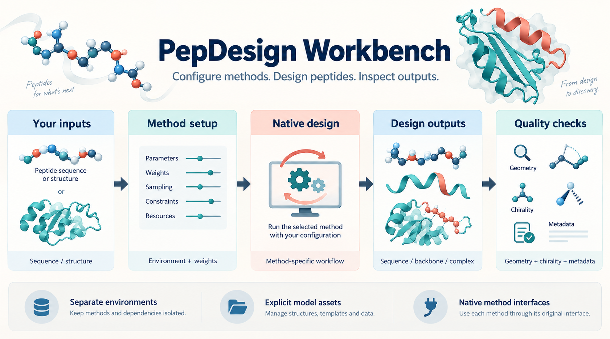
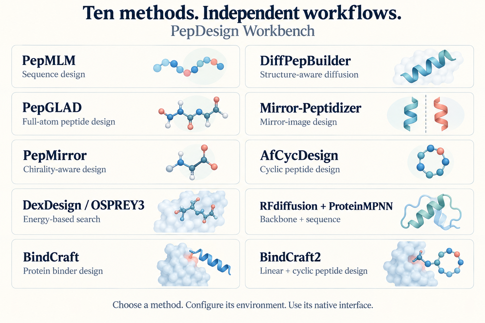

# PepDesign Workbench

**多方法、多形态多肽设计工作台。** 从输入准备、独立环境与模型资产配置，到原生设计和产物检查，为不同设计方法提供清晰的使用入口。

[开始使用](docs/getting-started.md) · [方法目录](docs/methods/README.md) · [环境与权重](docs/environments.md) · [输入与输出](docs/inputs-outputs.md) · [English](README.en.md)



## 平台提供什么

- **10 种独立方法**：按输入、产物、拓扑和手性需求选择原生流程。
- **可核对的配置**：固定源码参考、官方安装与权重入口、通用路径模板。
- **方法独立配置**：BindCraft 与 BindCraft2 分别维护文档、配置和环境。
- **产物分层检查**：区分序列、骨架和全原子复合物，记录手性、连通性与几何信息。

当前工作台提供配置与文档入口，计算由各方法的原生软件完成。模板使用用户自备输入；方法源码和模型资产在工作台之外安装。

## 按任务选择方法

| 方法 | 主要输入 | 原生产物 | 形态与手性关注点 | 使用入口 |
| :--- | :--- | :--- | :--- | :--- |
| PepMLM | 受体序列、肽长 | 多肽序列 | 线性序列；序列本身不编码 L/D 构象 | [配置](docs/methods/pepmlm.md) |
| DiffPepBuilder | 受体结构、位点条件 | 多肽序列与结构 | 结构条件扩散；手性需检查产物坐标 | [配置](docs/methods/diffpepbuilder.md) |
| PepGLAD | 受体结构、结合区域 | 全原子多肽与复合物 | 全原子生成；逐残基检查手性 | [配置](docs/methods/pepglad.md) |
| Mirror-Peptidizer | L 受体结构、肽长 | 镜像设计的序列与结构 | D 肽设计路线；检查最终反射与修复后的坐标 | [配置](docs/methods/mirror-peptidizer.md) |
| PepMirror | 结构、口袋定义、模板 | 多肽序列与复合物 | 手性感知；拓扑由原生模板决定 | [配置](docs/methods/pepmirror.md) |
| AfCycDesign / ColabDesign | 受体或环肽结构、环化约束 | 环肽序列与预测结构 | cyclic offset；闭环几何单独检查 | [配置](docs/methods/afcycdesign.md) |
| DexDesign / OSPREY3 | 已准备的 D/L 复合物、搜索空间 | 序列、构象与能量搜索输出 | D 肽能量搜索；依赖显式构象库和化学准备 | [配置](docs/methods/dexdesign.md) |
| RFdiffusion + ProteinMPNN | 受体结构、contig / hotspot | 骨架、序列 | 骨架生成与序列设计两个原生步骤 | [配置](docs/methods/rfdiffusion-proteinmpnn.md) |
| BindCraft | 受体结构、长度与可选位点 | binder 序列、结构与原生过滤结果 | 蛋白 / 迷你蛋白；另有线性肽预设 | [配置](docs/methods/bindcraft.md) |
| BindCraft2 | 受体结构、modality、campaign | 序列、复合物与原生过滤结果 | 本工作台提供线性 L 肽和 cyclic L 肽配置 | [配置](docs/methods/bindcraft2.md) |

方法目录描述原生设计路线。L、D、mixed 与 unknown 应在实际产物中分别记录；支持某种路线不等于每个输出都满足该手性或具备实验活性。

<details>
<summary>查看 10 种方法的说明图</summary>



</details>

## 开始使用

1. 阅读[入门指南](docs/getting-started.md)，选择一个方法并核对其官方来源与许可证。
2. 在独立目录安装该方法的环境和模型资产。
3. 按[输入说明](docs/inputs-outputs.md)准备自己的序列或结构，填写方法配置。
4. 在该方法源码目录中调用原生命令，保留配置和原始产物。
5. 按[产物检查指南](docs/quality-checks.md)检查输出，分别记录运行状态和候选质量。

配置入口：[BindCraft](configs/bindcraft/README.md) · [BindCraft2 线性 / 环肽](configs/bindcraft2/README.md) · [其他原生配置](configs/README.md)。

## 项目结构

```text
docs/       使用指南、各方法说明与平台图片
configs/    通用原生配置模板和 API / notebook 输入约定
registry/   方法标识、官方来源与源码参考
scripts/    公开文件结构、链接与配置检查
tests/      发布检查测试
```

本仓库检查只需 Python 标准库，不下载权重或启动模型：

```bash
python scripts/check_public_tree.py
python -m unittest discover -s tests -v
```

## 来源与许可

本工作台自编内容采用 [MIT License](LICENSE)。方法均归原作者所有，请按[来源登记](registry/methods.json)访问官方项目。各方法的源码、权重与依赖分别适用其官方条款；BindCraft2 的许可独立于 BindCraft。详见[许可说明](docs/licenses.md)。

两张说明图通过 Image Gen 生成，分子图形为流程插画。维护方式见[贡献指南](CONTRIBUTING.md)。
